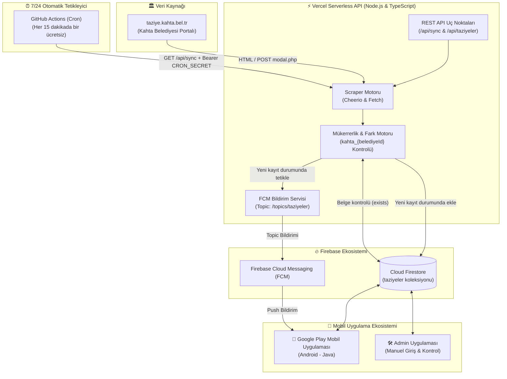

# 🕊️ Antikor 8.0 Taziye Sistemi

> **Bu proje Antikor 8.0 Taziye Sistemidir.**

Bu sistem, [taziye.kahta.bel.tr](https://taziye.kahta.bel.tr/) üzerindeki taziye ilanlarını 7/24 periyodik olarak tarayan, **Cloud Firestore** veritabanına otomatik senkronize eden ve Google Play'deki **Android (Java)** mobil uygulamanıza **Firebase Cloud Messaging (FCM)** üzerinden anlık push bildirim gönderen yüksek erişilebilirlikli, sunucusuz (serverless) bir otomasyon altyapısıdır.

---

## 🏛️ Mimari Şema



---

## 🚀 Temel Özellikler

- **Çift Aşamalı Akıllı Scraper:** Ana sayfadaki taziye kartlarının yanı sıra `modal.php` uç noktasından cenaze namazı saati, defin yeri, mezarlık, taziye evi ve akrabalık bağları gibi tüm derinlikli bilgileri çeker.
- **%100 Mükerrer Kayıt Koruması (Deduplication):** Her ilanın belediye ID'sini (`kahta_809` vb.) benzersiz bir belge kimliği (Document ID) olarak kullanır. Sistem daha önce eklenen kayıtları atlar ve kullanıcılara aynı bildirimi asla tekrar göndermez.
- **Anlık FCM Push Bildirimi:** Yeni bir vefat ilanı eklendiğinde kayıtlı tüm Android kullanıcılara özelleştirilmiş başlık ve taziye evi bilgisiyle yüksek öncelikli bildirim iletir.
- **Admin App ile Çift Yönlü Uyumluluk:** Eskiden tek tek manuel girdiğiniz Admin uygulamasını kapatmanıza gerek kalmaz. Sistem otomatik çekilenleri `kaynak: "belediye_otomatik"`, admin ilanlarını `kaynak: "admin_manuel"` olarak etiketler; her iki kaynak Firestore'da kusursuz birlikte yaşar.
- **Sıfır Sunucu Maliyeti (Serverless):** Vercel Serverless ve GitHub Actions altyapısı sayesinde 7/24 kesintisiz, sunucu kiralama ücreti olmadan çalışır.

---

## 📦 Firestore Veri Modeli

Firestore `taziyeler` koleksiyonundaki her belgenin şeması:

```json
{
  "id": "kahta_809",
  "belediyeId": "809",
  "adSoyad": "HALİME YANAK",
  "yas": "76",
  "vefatTarihi": "18.10.2026",
  "yakiniAdSoyad": "H. OSMAN YANAK",
  "yakinlik": "EŞİ",
  "yakiniGsm": "0535 510 13 35",
  "cenazeNamazi": "SAAT 10:00'DA AKKUŞ KÖYÜ",
  "definYeri": "AKKUŞ KÖYÜ ĞIREWE",
  "definIlIlce": "KAHTA / ADIYAMAN",
  "taziyeEvi": "AKKUŞ KÖYÜ TAZİYE EVİ",
  "taziyeAdresi": "",
  "ayrintiliYakinlik": "MAHMUT, İHSAN,RAMAZAN, İSMAİL VE ŞUAYİP YANAK'IN ANNESİ",
  "kaynak": "belediye_otomatik",
  "durum": "aktif",
  "olusturulmaTarihi": "2026-10-18T22:46:04.579Z",
  "olusturulmaTimestamp": "(Firestore ServerTimestamp)"
}
```

---

## 📱 Android (Java) Uygulama Entegrasyonu

### 1. FCM Bildirim Konusuna Abone Olma
`MainActivity.java` sınıfınızın `onCreate` metodunda kullanıcıları taziye bildirim konusuna abone edin:

```java
import com.google.firebase.messaging.FirebaseMessaging;

FirebaseMessaging.getInstance().subscribeToTopic("taziyeler")
    .addOnCompleteListener(task -> {
        if (task.isSuccessful()) {
            Log.d("AntikorTaziye", "Taziyeler konusuna başarıyla abone olundu.");
        }
    });
```

### 2. Firestore'dan Verileri Dinleme
Verileri en yeni eklenen ilan en üstte olacak şekilde dinleyin:

```java
import com.google.firebase.firestore.FirebaseFirestore;
import com.google.firebase.firestore.Query;

FirebaseFirestore db = FirebaseFirestore.getInstance();
db.collection("taziyeler")
    .orderBy("olusturulmaTimestamp", Query.Direction.DESCENDING)
    .addSnapshotListener((snapshots, error) -> {
        if (error != null) {
            Log.e("AntikorTaziye", "Veri dinleme hatası", error);
            return;
        }
        if (snapshots != null) {
            // Listenizi güncelleyin
        }
    });
```

---

## 🌐 API Uç Noktaları

| Uç Nokta | Metot | Açıklama | Yetki |
| :--- | :--- | :--- | :--- |
| `/api/sync` | `GET` / `POST` | Taziye taramasını başlatır, Firestore'a kaydeder ve FCM bildirimi atar. | `CRON_SECRET` Gerekli |
| `/api/taziyeler` | `GET` | Belediye sitesindeki mevcut ilanları ham JSON olarak listeler. | Herkese Açık |

---

## 👥 Hazırlayanlar

- **Muhammed Yasin KORKUT**
- **Tahircan ASLAN**

---

## 📄 Lisans & Telif Hakkı

Bu yazılım [MIT Lisansı](LICENSE) kapsamında lisanslanmıştır.

**© 2023 Korkut Teknoloji, Yazılım ve Medya A.Ş.** Tüm hakları saklıdır.
