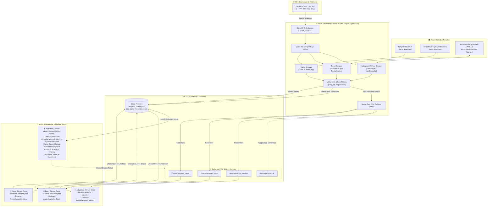

# 🕊️ Antikor 8.0 - Adıyaman & İlçeleri Taziye Otomasyon Ekosistemi

> **Bu proje Antikor 8.0 Taziye Sistemidir.**

Bu sistem; **Kahta**, **Besni** ve **Adıyaman Merkez** belediyelerinin resmi taziye portallarını **7/24 saatlik periyotlarla** otomatik tarayan, her ilçeyi kendi bağımsız **FCM Push Bildirim Konularına (Topics)** ileten, ortak **Cloud Firestore** veritabanına mükerrersiz senkronize eden ve gelecekte yayınlanacak olan **Kahta Güncel Cepte**, **Besni Güncel Cepte**, **Adıyaman Güncel Cepte** mobil uygulamaları ile **Adıyaman Güncel Admin** yönetim panelini tek merkezden besleyen kurumsal, modüler ve sunucusuz (serverless) bir otomasyon omurgasıdır.

---

## 🏛️ Uçtan Uca Çoklu İlçe (Multi-District) Mimarisi



---

## 📌 Desteklenen İlçeler ve Kaynak Detayları

| İlçe | Kaynak URL | Kazıma Yöntemi | Üretilen Benzersiz ID | FCM Bildirim Konusu | Hedef Mobil Uygulama |
| :--- | :--- | :--- | :--- | :--- | :--- |
| **Kahta** | `https://taziye.kahta.bel.tr` | Ana kartlar + `modal.php` POST | `kahta_{belediyeId}` | `taziyeler_kahta` (ve `taziyeler`) | Kahta Güncel Cepte |
| **Besni** | `https://besni.bel.tr/sayfa/VefatEdenler` | ASP.NET `.vefat` ayrıştırma + Telefon regex | `besni_{slug}-{hash}` | `taziyeler_besni` | Besni Güncel Cepte |
| **Adıyaman Merkez** | `https://adiyaman.bel.tr/TAZIYE-ILANLARI` | `.card-taziye` + `xgetData.php` POST | `merkez_{id}` | `taziyeler_merkez` | Adıyaman Güncel Cepte |

---

## 🛠️ "Adıyaman Güncel Admin" Merkezi Kontrol Altyapısı

Kullanıcı gereksinimi doğrultusunda **Adıyaman Güncel Admin** paneli, Adıyaman iline bağlı tüm ilçeleri tek bir çatı altından yönetebilir:

1. **Tek Koleksiyon Standardı (`taziyeler`):**
   - Tüm taziye belgeleri `taziyeler` koleksiyonunda saklanır.
   - Her belgede `ilce: 'kahta' | 'besni' | 'merkez'` ve `ilceAdi: 'Kahta' | 'Besni' | 'Adıyaman Merkez'` alanları zorunlu olarak yer alır.
   - **Admin Paneli Sorgusu:**
     ```typescript
     // Tüm Adıyaman'daki vefatları en yeniden en eskiye listeleme:
     db.collection('taziyeler').orderBy('olusturulmaTimestamp', 'desc').limit(50);
     
     // Sadece Besni'yi listeleme:
     db.collection('taziyeler').where('ilce', '==', 'besni').orderBy('olusturulmaTimestamp', 'desc');
     ```

2. **Manuel İlan & Bildirim Gönderme:**
   - Admin panelinden manuel vefat ilanı girildiğinde ilçe seçilir (`Kahta`, `Besni`, `Merkez`).
   - Sistem ilgili ilanın belgesini oluşturur ve **sadece o ilçenin FCM konusuna** (`taziyeler_besni` vb.) yüksek öncelikli bildirim gönderir.

3. **Gelişmiş Filtreleme:**
   - İlçe bazlı filtreleme: `Tümü`, `Kahta`, `Besni`, `Merkez`.
   - Durum bazlı filtreleme: `aktif`, `arsiv`.
   - Kaynak bazlı filtreleme: `belediye_otomatik`, `admin_manuel`.

---

## 📱 Mobil Uygulamalar İçin Android (Java/Kotlin) Entegrasyon Rehberi

### 1. Besni Güncel Cepte
```java
// MainActivity.java veya Application sınıfı:
FirebaseMessaging.getInstance().subscribeToTopic("taziyeler_besni");

// Firestore'dan sadece Besni taziyelerini çekme:
FirebaseFirestore.getInstance()
    .collection("taziyeler")
    .whereEqualTo("ilce", "besni")
    .whereEqualTo("durum", "aktif")
    .orderBy("olusturulmaTimestamp", Query.Direction.DESCENDING)
    .addSnapshotListener((snapshots, e) -> {
        // Besni listesini güncelle
    });
```

### 2. Adıyaman Güncel Cepte (Merkez & İl Geneli)
```java
// Sadece Merkez bildirimleri için:
FirebaseMessaging.getInstance().subscribeToTopic("taziyeler_merkez");
// VEYA tüm il genelini dinlemek isterse:
FirebaseMessaging.getInstance().subscribeToTopic("taziyeler_all");

// Firestore'dan listeleme (Merkez veya tüm il):
FirebaseFirestore.getInstance()
    .collection("taziyeler")
    .whereEqualTo("ilce", "merkez")
    .orderBy("olusturulmaTimestamp", Query.Direction.DESCENDING)
    ...
```

### 3. Kahta Güncel Cepte
```java
FirebaseMessaging.getInstance().subscribeToTopic("taziyeler_kahta");
// Geriye dönük uyumluluk için eski "taziyeler" konusu da sistem tarafından desteklenmektedir.
```

---

## 🔌 Geliştirici API Uç Noktaları

| Uç Nokta | Metot | Açıklama | Parametreler |
| :--- | :--- | :--- | :--- |
| `/api/taziyeler` | `GET` | Belediyelerden canlı çekilen ham taziye verilerini döner. | `?ilce=besni`, `?ilce=merkez`, `?ilce=kahta` (boşsa tümü) |
| `/api/sync` | `GET / POST` | Otomasyon taramasını başlatır, Firestore'a senkronize eder ve yeni kayıtlar için FCM bildirimi gönderir. | `?ilce=besni` (opsiyonel), `Bearer CRON_SECRET` |
| `/api/list` | `GET` | Firestore'da kayıtlı taziyeleri ilçe ve duruma göre filtreleyerek listeler. | `?ilce=besni`, `?durum=aktif`, `?limit=50` |
| `/api/admin` | `POST` | Admin panelinden manuel taziye ekler ve ilçeye anında FCM bildirimi gönderir. | JSON body + `Bearer ADMIN_SECRET` |
| `/api/admin` | `PUT / DELETE` | Var olan taziyeyi arşivler, günceller veya siler. | JSON body + `Bearer ADMIN_SECRET` |

---

## 🚀 Yerel Geliştirme ve Test Komutları

```bash
# Bağımlılıkları yükleyin
npm install

# Tüm ilçelerin canlı scraper'larını test edin (Kahta, Besni, Merkez):
npm run test:scrape

# Yerel ortamda senkronizasyon ve bildirim testini çalıştırın:
npm run dev

# Sadece tek bir ilçeyi yerel olarak senkronize etmek için:
npx ts-node src/cli.ts --ilce=besni
npx ts-node src/cli.ts --ilce=merkez
npx ts-node src/cli.ts --ilce=kahta

# TypeScript derlemesini kontrol edin:
npm run build
```

---

## 🔒 Ortam Değişkenleri (.env)

```env
# Firebase Yönetici Kimliği (JSON string veya Base64)
FIREBASE_SERVICE_ACCOUNT='{"type":"service_account","project_id":"...","private_key":"...","client_email":"..."}'

# Koleksiyon Adı
FIRESTORE_COLLECTION="taziyeler"

# İlçelere Özel FCM Konuları
FCM_TOPIC_KAHTA="taziyeler_kahta"
FCM_TOPIC_BESNI="taziyeler_besni"
FCM_TOPIC_MERKEZ="taziyeler_merkez"
FCM_TOPIC="taziyeler"
FCM_TOPIC_ALL="taziyeler_all"

# Güvenlik Anahtarları
CRON_SECRET="guvenlik_anahtari_2026"
ADMIN_SECRET="admin_anahtari_2026"
```

---

## 👥 Proje Künyesi
- **Sistem Adı:** Antikor 8.0 - Adıyaman & İlçeleri Taziye Otomasyon Ekosistemi
- **Hazırlayanlar:** **Muhammed Yasin KORKUT** ve **Tahircan ASLAN**
- **Telif Hakkı:** © 2026 Korkut Teknoloji, Yazılım ve Medya A.Ş. Tüm hakları saklıdır.
