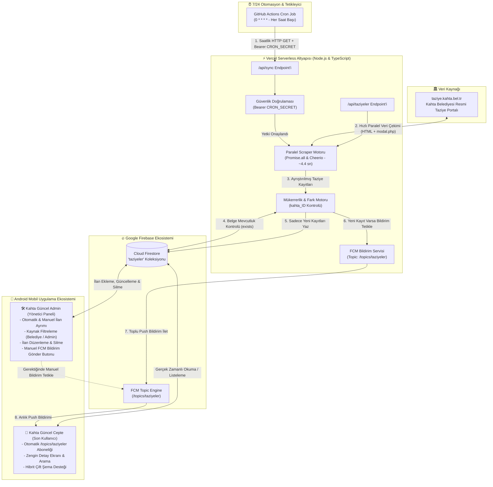

# 🕊️ Antikor 8.0 Taziye Sistemi

> **Bu proje Antikor 8.0 Taziye Sistemidir.**

Bu sistem, [taziye.kahta.bel.tr](https://taziye.kahta.bel.tr/) üzerindeki taziye ilanlarını **7/24 saatlik periyotlarla** tarayan, yüksek hızlı paralel kazıma (scraping) motoru ile saniyeler içinde işleyen, **Cloud Firestore** veritabanına otomatik senkronize eden ve Google Play'deki **Android (Java)** mobil uygulamanıza **Firebase Cloud Messaging (FCM)** üzerinden anlık push bildirim gönderen yüksek erişilebilirlikli, sunucusuz (serverless) bir otomasyon ve yönetim ekosistemidir.

---

## 🏛️ Uçtan Uca Sistem Mimarisi



---

## ⚡ Ekosistem Bileşenleri ve Yetenekleri

### 1. 🤖 Backend Scraper & Sync Engine (`d:\antikor-taziye`)
- **Yüksek Hızlı Paralel Kazıma:** Sıralı döngü yerine `Promise.all` ile eş zamanlı HTTP istekleri yaparak 18 ilanın tüm detaylarını (cenaze namazı, defin yeri, mezarlık, taziye evi, akrabalık bağları vb.) **26 saniye yerine sadece ~4.40 saniyede** eksiksiz çeker.
- **Vercel Serverless Güvencesi:** `vercel.json` üzerinde tanımlı `maxDuration: 60` ayarı sayesinde zaman aşımı (timeout) riski ortadan kaldırılmıştır.
- **Akıllı Mükerrer Kayıt Önleme (Deduplication):** Belediye ID'sini (`kahta_813` vb.) Document ID olarak kullanır. Sistem veritabanında zaten var olan kayıtları atlar ve asla mükerrer bildirim göndermez.
- **Güvenli Erişim:** `/api/sync` uç noktası `Bearer CRON_SECRET` başlığı ile yetkilendirilmemiş isteklere karşı korunur.

### 2. ⏰ 7/24 Kesintisiz GitHub Actions Cron (`.github/workflows/cron.yml`)
- **Saatlik Otomasyon:** `0 * * * *` cron kuralı ile her saat başı tetiklenir.
- **Sıfır Maliyet:** Bilgisayarınız kapalı olsa dahi bulutta 7/24 tamamen ücretsiz çalışır.

### 3. 🛠️ Kahta Güncel Admin Uygulaması (`kahtagunceladmin`)
- **Çift Şema (Dual-Schema) Uyumluluğu:** Hem botun eklediği yeni alanları (`adSoyad`, `yas`, `yakiniGsm`, `taziyeEvi`) hem de eski admin paneli alanlarını (`vefatEden`, `yasi`, `yakiniTel`, `taziyeYeri`) hibrit getter fonksiyonları ile sorunsuz okur ve günceller.
- **Kaynak Ayrımı & Rozetler:** İlanların belediye botu tarafından mı (`belediye_otomatik`) yoksa yönetici tarafından mı (`admin_manuel`) eklendiği renkli rozetlerle listelenir.
- **Gelişmiş Filtreleme:** Üst barda yer alan sekmelerle *Tümü*, *Belediye (Bot)* veya *Admin (Manuel)* filtrelenebilir.
- **Manuel FCM Bildirim Tetikleme:** Güncelleme ekranında yer alan **"Bildirim Gönder"** butonu sayesinde, istenildiğinde kayıtlı kullanıcılara tek tıkla FCM bildirimi yeniden iletilebilir.

### 4. 📱 Kahta Güncel Cepte Kullanıcı Uygulaması (`KahtaGncelCeptee`)
- **Otomatik Topic Aboneliği:** Uygulama açılışında `MainActivity.java` içinde kullanıcılar arka planda `FirebaseMessaging.getInstance().subscribeToTopic("taziyeler")` konusuna otomatik abone edilir.
- **Zengin Taziye Detayı:** Vefat edenin yaşı, cenaze namazı vakti/yeri, defin mezarlığı, taziye evi adresi, taziye yakını ve telefon numarası (tek tıkla arama) modern kart tasarımında sunulur.

---

## 📦 Firestore Hibrit Veri Modeli

Firestore `taziyeler` koleksiyonundaki her belgenin veri yapısı:

```json
{
  "id": "kahta_813",
  "belediyeId": "813",
  "adSoyad": "MEHMET SİNAN KURT",
  "vefatEden": "MEHMET SİNAN KURT",
  "yas": "64",
  "yasi": "64",
  "vefatTarihi": "20.10.2026",
  "yakiniAdSoyad": "MEHMET KURT",
  "yakinlik": "BABASI",
  "yakiniGsm": "0532 123 45 67",
  "yakiniTel": "0532 123 45 67",
  "cenazeNamazi": "ÖĞLE NAMAZINA MÜTEAKİP ÇARŞI CAMİİ",
  "definYeri": "KARŞIYAKA MEZARLIĞI",
  "definIlIlce": "KAHTA / ADIYAMAN",
  "taziyeEvi": "CELAL TAZİYE EVİ",
  "taziyeYeri": "CELAL TAZİYE EVİ",
  "taziyeAdresi": "Yavuz Selim Mah. Kahta",
  "ayrintiliYakinlik": "ALİ, HAKAN VE AHMET KURT'UN BABASI",
  "kaynak": "belediye_otomatik",
  "durum": "aktif",
  "olusturulmaTarihi": "2026-10-21T10:45:12.345Z",
  "olusturulmaTimestamp": "(Firestore ServerTimestamp)"
}
```

---

## 🔑 Ortam Değişkenleri ve Kurulum

### 1. Vercel Dashboard Ayarları
Vercel projenizin **Settings > Environment Variables** menüsünden aşağıdaki anahtarları tanımlayın:

| Anahtar Adı | Örnek Değer | Açıklama |
| :--- | :--- | :--- |
| `CRON_SECRET` | `kahta_taziye_guvenlik_anahtari_2026` | Senkronizasyon endpoint'ini koruyan güvenlik anahtarı |
| `FIRESTORE_COLLECTION` | `taziyeler` | Firestore'da taziye kayıtlarının tutulduğu koleksiyon |
| `FCM_TOPIC` | `taziyeler` | Kullanıcıların abone olduğu bildirim topic adı |
| `FIREBASE_SERVICE_ACCOUNT` | `{"type": "service_account", ...}` | Firebase Admin SDK JSON dosyasının metin içeriği |

### 2. GitHub Secrets Ayarları
GitHub deponuzun (`Yasin0234/kahta-taziye`) **Settings > Secrets and variables > Actions** sayfasına gidin:
- **Secret Name:** `CRON_SECRET`
- **Secret Value:** `kahta_taziye_guvenlik_anahtari_2026`

---

## 🌐 API Uç Noktaları

| Uç Nokta | Metot | Açıklama | Yetki |
| :--- | :--- | :--- | :--- |
| `/api/sync` | `GET` / `POST` | Taziye taramasını başlatır, Firestore'a kaydeder ve FCM bildirimi atar. | `CRON_SECRET` (Bearer Token) Gerekli |
| `/api/taziyeler` | `GET` | Belediye sitesindeki mevcut ilanları ham JSON olarak listeler. | Herkese Açık |

---

## 👥 Proje Ekibi & Geliştiriciler

- **Muhammed Yasin KORKUT**
- **Tahircan ASLAN**

---

## 📄 Lisans & Telif Hakkı

Bu yazılım [MIT Lisansı](LICENSE) kapsamında lisanslanmıştır.

**© 2023 - 2026 Korkut Teknoloji, Yazılım ve Medya A.Ş.** Tüm hakları saklıdır.
